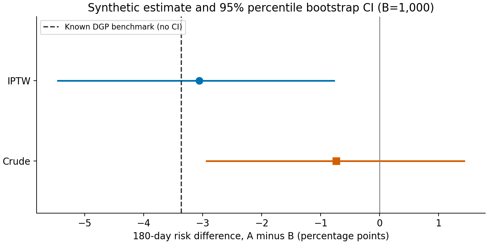
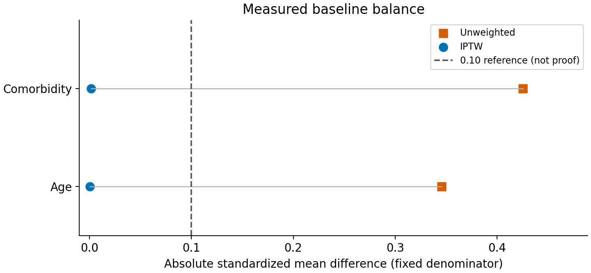
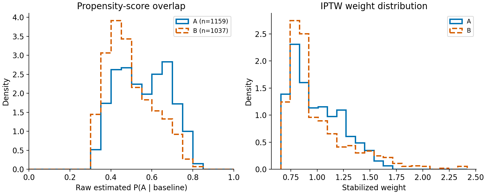

# Reproducible synthetic target-trial report

**Not clinical evidence. All source rows and outcomes were generated locally.**

## Question and estimand

What is the 180-day risk difference for initiating A versus B among eligible new
users? The primary estimator is the difference of normalized, stabilized-IPTW
group risks (Hajek-style). See [the protocol](../../PROTOCOL.md) for the design.
No real treatment, institution, employer, or research participant is represented.

## Cohort and data contract

Source seed: 20260907; generated people: 3,000; eligible people: 2,196.
One row per person in all three source tables; no orphan/missing IDs, required
values, or invalid binary codes; complete follow-up required. NULL event day
means confirmed event-free follow-up, not missing ascertainment. Validation
fails rather than silently dropping broken joins or incomplete follow-up.

Sequential exclusions (a person is counted once):

| step | remaining | excluded |
| --- | --- | --- |
| Generated people | 3000 | 0 |
| Age 50-90 | 2848 | 152 |
| Prior enrollment >=365 days | 2388 | 460 |
| No prior class use | 2196 | 192 |

Group descriptives; age SD is the sample SD, events are observed synthetic events:

| treatment | n | events | age_mean | age_sd | comorbidity_prevalence | crude_risk | weighted_risk | effective_sample_size |
| --- | --- | --- | --- | --- | --- | --- | --- | --- |
| A | 1159 | 82 | 68.2347 | 8.9298 | 0.4590 | 0.0708 | 0.0623 | 1096.9901 |
| B | 1037 | 81 | 65.2343 | 8.4350 | 0.2594 | 0.0781 | 0.0929 | 951.1512 |

## Main effect and uncertainty

Risks and differences in the table are proportions. Multiply by 100 for percentage points.

| method | estimate | ci_lower | ci_upper |
| --- | --- | --- | --- |
| Crude | -0.0074 | -0.0295 | 0.0145 |
| IPTW | -0.0306 | -0.0547 | -0.0076 |

IPTW estimate: **-3.06 percentage points**, 95% percentile
bootstrap CI **[-5.47, -0.76]**.
The known DGP benchmark for these eligible baseline covariates is
-3.36 percentage points. It is computed from generating probabilities,
not observed counterfactual outcomes; it is not an exact population effect.

Bootstrap: 1,000 scheduled independent-person pairs resamples,
seed 8675309; propensity model, treatment prevalence, and weights
refitted for every resample. No resamples were silently discarded or redrawn.
This interval does not incorporate unmeasured confounding, measurement error,
or uncertainty about the chosen causal model; coverage is not validated here.

## Balance, overlap, and weights

| covariate | smd_before | smd_after |
| --- | --- | --- |
| age | 0.3456 | 0.0004 |
| comorbidity | 0.4254 | 0.0014 |

SMD uses a fixed unweighted pooled population-SD denominator for both comparisons.
The 0.10 guide is a diagnostic convention, not evidence that exchangeability holds.
Raw estimated propensity range: [0.3234, 0.8048].
Numerical clipping policy: [0.01, 0.99]; 0 clipped scores.
Mean weight: 1.0001; maximum: 2.4186;
99th percentile: 1.8142; pooled ESS: 2047.6
of 2196 people. ESS is a weight diagnostic, not an inferential sample size.
Rank deficiency, separation, or nonconvergence stops estimation.

Both histograms use 20 shared bins per panel and density normalization within
each treatment group; input observations are in cohort.csv. Unit: independent
synthetic person. These graphs do not establish positivity in unseen populations.

## Prespecified weight sensitivity (descriptive)

| policy | risk_difference | maximum_weight | effective_sample_size | maximum_smd_after | changed_weights |
| --- | --- | --- | --- | --- | --- |
| No winsorization | -0.0306 | 2.4186 | 2047.5887 | 0.0014 | 0 |
| 1st/99th percentiles | -0.0301 | 1.8142 | 2057.4245 | 0.0140 | 43 |
| 5th/95th percentiles | -0.0279 | 1.5269 | 2073.6168 | 0.0397 | 215 |

Quantile winsorization caps pooled weights without removing people. It can trade
variance for bias and alter the weighted target; it is not a cure for failed
positivity. No sensitivity-analysis CIs or hypothesis tests were computed.
Do not select a policy by whether its estimate is significant.

## Repeated simulation check

Scheduled 100 consecutive seeds; 100 successful, 0 failed. Crude mean error 0.0233, RMSE 0.0249; IPTW mean error -0.0022, RMSE 0.0100.

Every scheduled seed and any failure is in simulation_runs.csv. Errors are
relative to the corresponding finite-cohort DGP benchmark. Monte Carlo SEs of
mean errors are recorded in manifest.json when at least two runs succeed.
This evaluates point-estimator behavior in ONE favorable, correctly specified,
measured-confounding mechanism. It is not external validation or a CI-coverage study.

## Reproduce and limitations

Configuration, library versions, code hashes, and artifact hashes are in
manifest.json. CSVs include all synthetic source rows, cohort/weights, balance,
effects, sensitivity results, bootstrap estimates, and repeated-seed outcomes.

No censoring, competing risks, adherence changes, clustering, longitudinal
treatment, unmeasured confounding, or real-world missing-data mechanism is
implemented. Day 0 is a relative initiation index, not a validated longitudinal
claims algorithm. The script does not import real records. Conclusions apply
only to this simulation. See [methods and references](../../docs/METHODS.md).
